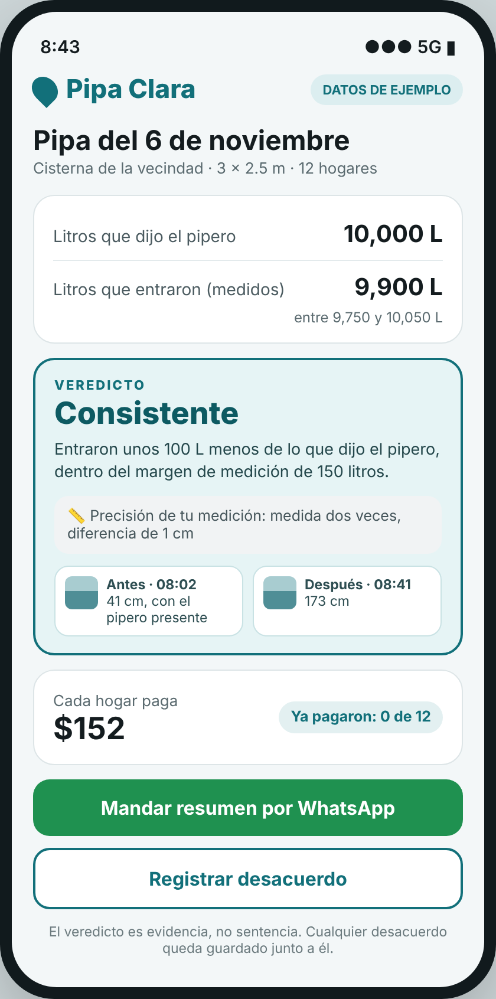
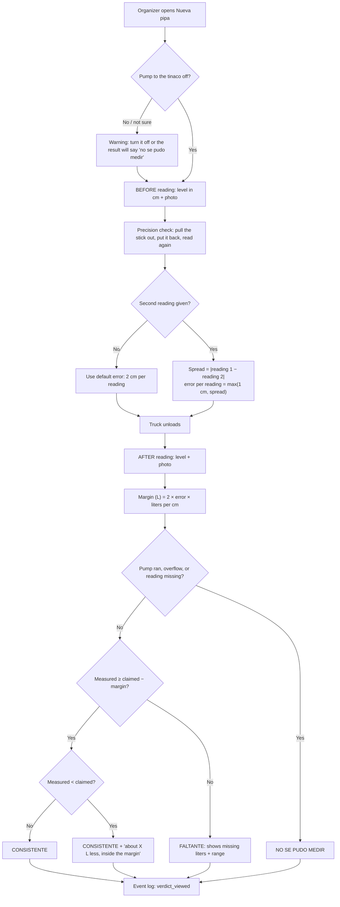
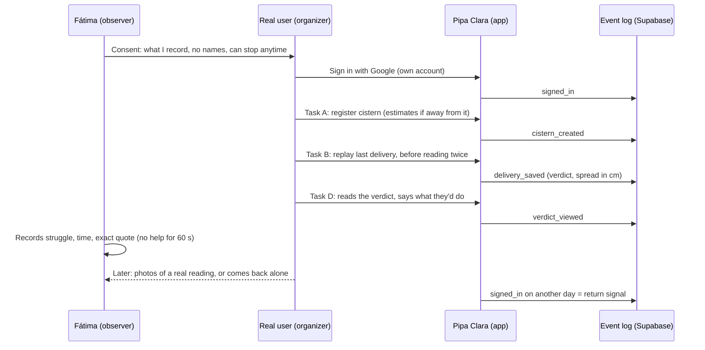

# Pipa Clara — Build Packet (Week 13, Real Humans)

**Founder:** Fátima Fortes Ortega · **Venture:** Pipa Clara · **Role this week:** Operator
**Inputs:** [`CHARTER.md`](CHARTER.md) · [`PERSONAS.md`](PERSONAS.md) · Week 12 packet [`PACKET-4.md`](PACKET-4.md) · [`DECISIONS.md`](DECISIONS.md) · Week 13 Brain Bending brief · Team 13 Blueprint
Written before any Week 13 code. No packet, no code.

---

## 1. The problem, in my words

Week 12 proved Pipa Clara works when I use it. It has never been used by someone who buys water and doesn't know me. Two things can kill it that no synthetic persona will show me:

1. **The number can lie.** The verdict depends on a level read with a stick or a tape measure. On a 3 × 2.5 m cistern every centimeter is 75 liters. Today the app assumes ±2 cm per reading for every cistern. If real people read worse than that, the app can call an honest delivery "short" and push a family into a fight with the driver. If they read better, the margin is hiding liters that a family that buys water out of necessity can't afford to lose.
2. **Real people may not get through it.** Strangers may not know their cistern's size, may not finish the readings while the driver waits, or may not trust the Google sign-in screen.

This week I put Pipa Clara in front of five real people, measure how precise their readings really are, and fix the worst thing they show me.

## 2. The exact user

**The organizer** (Persona Rosa): the person who orders the truck, pays the driver and collects from the households. This week, specifically: **people in CDMX who buy private pipas because the public supply doesn't arrive or takes too long**, recruited from university staff (security, cleaning, cafeteria, maintenance) and their cistern neighbors. **At least 3 of 5 are strangers to me.** I record their role and where I found them, never their name.

## 3. Success definition

**Before the module closes:**

- Five real people (at least three strangers) have tried Pipa Clara at **www.pipa-clara.site**, each session documented (role, task, struggle, exact quote, what they did).
- The verdict shows a **margin calculated from the cistern's own repeated readings**, and an honest message when the measured liters are below the claim but inside the margin.
- Every visit is recorded in an **event log**, so a return visit is visible without asking anyone.
- The **#1 pain from the sessions is fixed and redeployed**, with before/after evidence.
- At least **one user comes back on their own** (a repeat visit in the event log, a voluntary sign-up, or a message asking to use it again).

## 4. Mockup

*Generated from the screen description in Appendix A. Example data, labeled on screen. New this week: the repeated reading, the margin that comes from it, and the message for "below the claim but inside the margin".*

## 5. How the feature works

### 5.1 Flowchart: the precision check and the new verdict message

### 5.2 Swimlane: who does what in a real-user session

## 6. What I build this week

**Slice A — known before the sessions (build first):**

| # | Feature | Why | Acceptance |
|---|---|---|---|
| A1 | **Event log** `pc_events` | Required this week (stack floor); gives the return signal without asking | Each of: `signed_in`, `cistern_created`, `delivery_saved`, `verdict_viewed`, `summary_sent`, `challenge_saved` writes one row; a user only sees and writes their own rows; no free text, no IP, no device data |
| A2 | **Precision check** on the before reading | My Blueprint declaration: test reading accuracy with repeated measurements | Optional second reading of the same level; the spread is saved; the margin uses it; without it, the default 2 cm applies |
| A3 | **Honest uncertainty messages** | Brief, section 5: always show the real number, only accuse outside the margin | Verdict shows the range ("entre 8,400 y 9,000 L"); a consistent delivery below the claim says "unos X L menos, dentro del margen"; a pump question appears before the readings |
| A4 | **Retry once on `PGRST303`** | Open risk from Week 12: the first screen after sign-in can fail, and that is a stranger's first impression | A `PGRST303` answer is retried once after ~1 s; logged |
| A5 | **Strangers can sign in** | The shared Google OAuth client is in Testing mode: only listed test users can enter | Consent screen published (only `email`/`profile` scopes, no verification needed) or every tester added before their session; checked with an account that was never used before |

**Slice B — decided by the sessions (amendment before code):**

| # | Feature | Rule |
|---|---|---|
| B1 | **Fix for the #1 pain** | Chosen from the pain ranking (section 13), not from my preferences. Written as an addendum to this packet (`## 14. Addendum`) with the user quote that justifies it **before** its first commit. Before/after evidence: screenshot + the same task timed before and after. |

## 7. The engine change (precision)

- Liters per cm (unchanged): `length_m × width_m × 10`.
- **Error per reading:** `e = 2 cm` by default. If the before reading was taken twice: `e = max(1 cm, |r1 − r2|)`. The 1 cm floor stops a lucky identical pair from claiming impossible precision.
- **Margin:** `margin_L = round(2 × e × liters_per_cm)` (two readings, before and after).
- Verdict rules are unchanged: missing reading / pump ran / overflow / after ≥ max height → `couldnt_measure`, and then no liters number is shown.
- New output field: `belowClaimInsideMargin = measured < claimed && verdict = consistent`, used only for the message.
- Still pure arithmetic, no AI, checkable by hand. Example: 3 × 2.5 m → 75 L/cm. Readings 41 and 42 cm → e = 1 cm → margin 150 L (Week 12 fixed: 300 L). Readings 40 and 43 cm → e = 3 cm → margin 450 L, and the screen says the reading was imprecise.

## 8. Benchmark line

- **The best existing solution on Earth for this is** Nairobi's water ATMs: the meter sits at the point of sale, so the liters are never in dispute (Brain Bending brief, Week 13).
- **Mine localizes it by** measuring from the buyer's side, with no hardware and nobody's permission, and turning the household's own repeated readings into an honest margin, because in CDMX private pipas have no meter and no registry.

## 9. The long view

If this slice works, Pipa Clara knows how precise each cistern's measurement really is, which is what turns a household's reading from a suspicion into evidence. In three years that record lets buildings that order regularly choose the pipero who delivers full, and lets honest piperos who opt in show a verified history. Every load-bearing decision this week (margin from real error, no public record without consent, no accusation inside the margin) is there so that record can be trusted by both sides.

## 10. Scope cut: what I am NOT building this week

- No report sent to the water company or the pipero (the brief's "send to supplier" idea is a later phase).
- No public or shared pipero record; no pipero phone numbers stored (Blueprint condition 5).
- No AI reading of the photo; the user still types the level.
- No analytics service (Google Analytics, PostHog, etc.): the event log is one Supabase table.
- No new features beyond Slice A and the single #1 fix, even if users ask for them; requests go to DECISIONS.md as findings.
- No incentives paid to testers; the only thing I give is their cistern's real capacity.

## 11. Architecture and stack

Same stack as Week 12; only additions are listed.

| Layer | Choice | Change this week |
|---|---|---|
| Frontend | Next.js 16 (App Router) + React + Tailwind | Precision field, new verdict messages |
| Hosting | Vercel, **www.pipa-clara.site** | — |
| Auth | Supabase Auth, Sign in with Google (shared "semestre" project) | OAuth consent screen opened to strangers (A5) |
| Database | Supabase Postgres, RLS on every `pc_` table | **New:** `pc_events`; `pc_readings.repeat_level_cm` (nullable) |
| Files | Private bucket `pc_readings` | — |
| Logic | Pure functions `computeVerdict()`, `splitShares()` | `computeVerdict()` takes the optional repeat reading |
| Analytics | **`pc_events`** (organizer_id, name, delivery_id, created_at) | Names from a fixed list (CHECK constraint); RLS insert/select own rows; no update/delete |
| Repo | GitHub `fatimafortes/pipa-clara-venture` | Migration `…_pc_week13.sql` only adds `pc_` objects |

## 12. Security floor (checked before building)

1. **No secrets:** nothing new; keys stay in Vercel env vars.
2. **Auth:** unchanged; new tables only reachable when signed in.
3. **RLS:** `pc_events` with insert/select `organizer_id = auth.uid()`, no update/delete; the RLS test script gains event checks (account B can't read A's events).
4. **Validation:** repeat reading 0 – max height, same as the other levels; event names only from the fixed list.
5. **No real personal data in demos:** demo video uses an invented cistern labeled "DATOS DE EJEMPLO". Session notes use roles, never names; photos show only the cistern.

## 13. Test plan

**Mechanical pass**

- `computeVerdict()`: no repeat → margin as Week 12; spread 0 → 1 cm floor; spread 3 cm → margin triples; 80 L below the claim inside the margin → consistent + `belowClaimInsideMargin`; couldn't-measure cases still return no liters.
- Event log: each event writes one row; account B can't read A's events; an unknown event name is rejected by the database.
- `PGRST303`: simulated error is retried once and then succeeds.
- Sign-in with a Google account that was never a test user.
- Find at least one bug, fix it, redeploy, log it in DECISIONS.md.

**Persona pass (Layer 1, separate chat)**

- Rosa walks the new screens (pump question, second reading, new verdict messages) with the driver waiting; log every confusion; fix the worst.

**Real-user pass (Layer 2, the point of this week)**

- 5 sessions, at least 3 strangers, ~10 minutes, with consent. Part 1: story of the last delivery ("What's worse, a short delivery or a neighbor who doesn't pay?", "Did you try the government pipa first? How many days did you wait?", "Do you buy all year?"). Part 2: tasks A (cistern), B (replay delivery, before reading twice), C (split), D ("about X liters missing, what do you do now?"), silent observation, help only after 60 s. Part 3: ask for the next pipa photos, not compliments.
- **Precision check:** two readings of the same level with the stick pulled out in between; record the spread in cm.
- One sheet per session: role and where found, stranger yes/no, story, pain answer, tasks ✅/⚠️/❌ with time, spread, 2–3 exact quotes in Spanish, commitment.
- **Pain ranking:** score each finding 1–3 on severity, frequency, behavior, and threat to the 10:1 case. A false "short" verdict outranks anything cosmetic (Blueprint, Bet C). Warning signs of fixing the easy pain: my #1 is something I already knew how to fix, or a finding that contradicts my written prediction ranks low.
- **Return signal:** from `pc_events`, a `signed_in` on a different day by a tester, or a message they send on their own. "Would use again" in the session doesn't count.

**Kill conditions:** most testers can't produce a level reading at all; the spread of repeated readings is so large that the margin hides most short loads; nobody comes back.

## 14. Blueprint conditions honored

| Condition | How |
|---|---|
| 1. 3 of 5 strangers from the real segment, source recorded | Recruited from university staff and their cistern neighbors; sheet records role + source + stranger yes/no |
| 2. Realistic, uncoached task; exact words; behavior separate from interpretation | Task cards, 60-second rule, separate "what they did" / "what I think it means" columns |
| 3. Rank three pains by core-task damage; fix the real #1; before/after evidence | Section 13 ranking; Slice B addendum with quote before code; timed task before and after |
| 4. One independent return signal | `pc_events` repeat visit, voluntary sign-up or unprompted message |
| 5. Shadow clause | Consent first; roles not names; photos only of the cistern; no pipero record or phone stored; accusation only outside an honest margin |
| 6. No 10:1 claim without a baseline | Baseline from sessions: what they do today when a pipa looks short, and what it cost them |

---

## 15. Addendum: the #1 pain from real users

*Written after the five real-user sessions and before the Slice B code (PACKET §6, B1). Roles only, never names. Quotes as recorded in the founder's session notes.*

### Sessions

**Strangers: sessions 1, 2, 4 and 5 (4 of 5).** Session 3 (the father) is someone I knew. Blueprint condition 1 (at least 3 of 5) is met.

| # | Role (stranger?) | Worse: short pipa or a neighbor who doesn't pay? | Struggle (what they did) | Quote |
|---|---|---|---|---|
| 1 | Woman who organizes the pipas · stranger | **A neighbor who doesn't pay**: "I end up putting in the money and then I have to collect." | Couldn't find where to record each neighbor's payment. | "Esto me serviría para no tener que estar anotando todo en mi libreta." |
| 2 | Building security guard (doesn't pay; the administrator does) · stranger | Short pipa ("everyone comes to complain to me") | Needed help to find where to register the cistern; over 60 s on each step. | "Si usted no me explica no entendería nada, señorita." |
| 3 | Father, building with administration · known to me | Short pipa | Didn't know whether to enter the liters ordered or the liters received. Asked how much each apartment pays. | "Tendría que utilizarlo el administrador." |
| 4 | Young neighbor · stranger | **A neighbor who doesn't pay** (one always pays late) | Couldn't find how to attach the photo. | — |
| 5 | Neighbor, 20,000 L pipas, two suppliers · stranger | **A neighbor who doesn't pay** | Looked for a delivery history per supplier. | "Siempre acaba en discusión." |

**Unobserved use:** two of my relatives used the link alone, without me. They said it was hard, and they couldn't find the photo upload.

**Finding that may challenge the premise:** 3 of 5 already have a water meter on their cistern. Not recorded: whether the meter is on the city supply line (it doesn't measure the pipa) or where the pipa unloads (then the liters may not be in dispute for them). To ask in the next sessions; not addressed by this fix.

### Return signal (Blueprint condition 4)

One of the two relatives who used the link on her own (not one of the five observed sessions) **came back to the app later to send the WhatsApp summary.** After leaving, she couldn't find her way back to it, and she **messaged me a screenshot on her own initiative** (kept, with her name hidden). Honest limit: she is a relative, not a stranger, so this is a weaker kind of independence than a stranger coming back. It is also evidence for the #1 pain: she came back for the summary and couldn't find it.

### Pain ranking (severity, frequency, behavior, threat to the 10:1 case)

1. **What the organizer needs after the verdict can't be found.** Marking who paid is at the bottom of the verdict page, and the returning user couldn't get back to the WhatsApp summary. **The 3 people who organize or pay ranked "a neighbor who doesn't pay" as worse, which contradicts my written prediction that measurement was the main value.**
2. **First steps unclear:** what to fill first; "litros que dijo el pipero" read as liters ordered vs. received.
3. **Photo upload not found** (session 4 and both relatives).

**Warning-sign check (§13):** moving payments up is something I could have done before the sessions. What the sessions changed is *why*: for the people who pay, collecting is the job, not a detail under the verdict. The fix also covers the half I could not have predicted: the way back to the summary for someone who returns.

### The fix (B1), smallest

- On the verdict page, move "Pagos" right under "Cada hogar paga", with the heading **"¿Quién ya te pagó?"** and the instruction **"Toca cada hogar cuando te pague"**.
- Make **"Ya pagaron: X de N"** a link that jumps there.
- On the `/app` list, each pipa shows two clear actions: **"Ver pagos"** and **"Mandar resumen"**.
- No new data, no migration.
- **Before/after evidence:** screenshots of the verdict page and the `/app` list, plus the same task timed before and after ("you're back a day later: mark that Depto 2 paid and send the summary").

---

## Appendix A: mockup screen description

> Mobile screen, Spanish UI, app "Pipa Clara" (water-drop logo, teal and white), badge "DATOS DE EJEMPLO". Title "Pipa del 6 de noviembre". Rows: "Litros que dijo el pipero: 10,000 L" and "Litros que entraron (medidos): 9,900 L · entre 9,750 y 10,050 L". Teal verdict card: "Consistente" and below, smaller: "Entraron unos 100 L menos de lo que dijo el pipero, dentro del margen de medición de 150 litros." A small grey box: "Precisión de tu medición: medida dos veces, diferencia de 1 cm". Two photo thumbnails: "Antes · 08:02 · 41 cm, con el pipero presente" and "Después · 08:41 · 173 cm". Then "Cada hogar paga: $152", "Ya pagaron: 0 de 12", green button "Mandar resumen por WhatsApp", outlined "Registrar desacuerdo". Large readable text for a 55-year-old, flat, no clutter.
