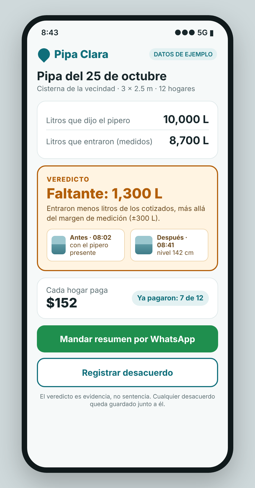
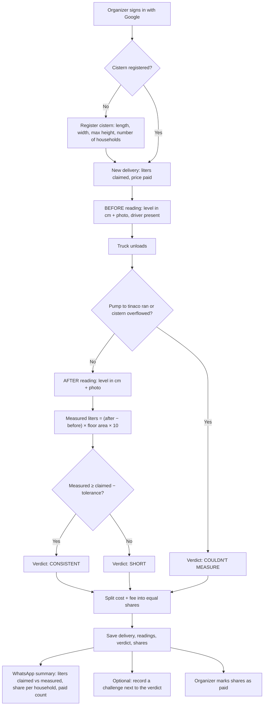
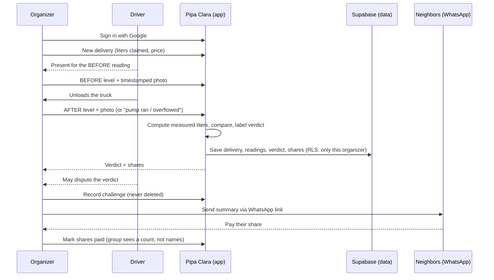

# Pipa Clara — Build Packet (Week 12, Core Build)

**Founder:** Fátima Fortes Ortega · **Venture:** Pipa Clara · **Charter:** [`docs/CHARTER.md`](CHARTER.md) · **Personas:** [`docs/PERSONAS.md`](PERSONAS.md)
Written before any code. No packet, no code.

---

## 1. The problem, in my words

When a water truck arrives, the only number anyone has is the one the driver says. The organizer pays it in full at the door, then has to collect from about a dozen households. When the water runs out early, nobody can tell whether the truck delivered less or a household used more, so the fight lands between neighbors. A complaint to the company goes nowhere because it is a suspicion, not evidence. Short loads are rare and spaced out, which is exactly why nobody ever has proof the day one happens.

## 2. The exact user

**The organizer** (Persona 1, Rosa, 55): the person who orders the truck, pays the driver, keeps the record and collects each household's share. Uses WhatsApp daily; other apps only if they are simple.
The neighbors (Persona 2, Claudia, 41) never open the app; they receive a WhatsApp summary and pay their share.

## 3. Success definition

**Before the module closes, an organizer can sign in with Google at the venture's real domain, register her cistern once, record a delivery (liters claimed, price, "before" and "after" readings with photos), get an honest verdict (consistent / short / couldn't measure), see each household's share, and send the summary to WhatsApp — and all of it is saved, so it is still there the next time she opens the app.**

## 4. Mockup

*Mockup of the core screen, the delivery verdict, generated as an HTML render from the screen description in Appendix A. Example data: a 3 × 2.5 m cistern (75 L per cm, tolerance ±300 L), 12 households, MXN 1,800 + MXN 24 fee.*

## 5. How the feature works

### 5.1 Flowchart

### 5.2 Swimlane: who does what

## 6. The engine (my Method, step 6)

**"Step 6 of my Method becomes the function that compares the liters the driver claims against the liters measured in the cistern, labels the delivery consistent / short / couldn't measure, and turns that verdict into each household's share of the cost."**

- **Claim:** liters the driver says.
- **Anchor:** the cistern level before and after, each with a timestamped photo; the "before" reading is taken with the driver present (Charter, Principle 1).
- **Measured liters:** `(after_cm − before_cm) × length_m × width_m × 10`.
- **Tolerance:** ±2 cm per reading, so `tolerance_L = 4 × length_m × width_m × 10` (a 2 × 2 m cistern → ±160 L, under 2% of a 10,000 L load).
- **Verdict:** `CONSISTENT` if measured ≥ claimed − tolerance · `SHORT` if below · `COULDN'T MEASURE` if a reading is missing, the pump to the tinaco ran during the unloading, or the cistern overflowed. "Couldn't measure" is a real answer, never a guess.
- **Deterministic, no AI.** The verdict is arithmetic the organizer can check by hand. Nothing is simulated in the core; if a demo uses example data, it is labeled "DATOS DE EJEMPLO" on screen.

## 7. Benchmark line

- **The best existing solution on Earth for this is** Bengaluru's Sanchari Cauvery: GPS-tracked public water tankers with a one-time code at delivery, so "it never arrived" becomes a missing record (Week 11 brief).
- **Mine differs by** checking *how much* arrived, not just *whether* it arrived, using an anchor the household controls (the cistern level) and witnessed by both sides, for private trucks, with no app needed by the neighbors or the driver.

## 8. The long view (light charter)

If this slice works, Pipa Clara becomes the record any place that buys water by truck keeps, from one vecindad to a network of communities, buildings and housing units, in CDMX and beyond. Once the measurement is proven accurate, water companies accept it as evidence, and a pattern of short loads becomes something the company has to fix, not something neighbors argue about. The driver stays the messenger; the responsibility sits with the company.

## 9. Scope cut: what I am NOT building this week

- No split by household consumption. Every household pays the same and the water is shared equally; how each household uses its part is up to them, not the app.
- No payments inside the app; it only records who has paid. Money still moves in cash or transfer.
- No sensors or hardware; a tape measure and the phone camera are the anchor.
- No AI reading of the tape photo; the organizer types the level and the photo is the evidence.
- No WhatsApp API or bot; the summary goes out through a `wa.me` share link.
- No accounts for neighbors or drivers; only the organizer signs in.
- No driver ratings, no marketplace, no chat (Charter, Non-goals).
- No complaint sent to the water company yet; the challenge is recorded in the app only.

## 10. Architecture and stack

| Layer | Choice | Why |
|---|---|---|
| Frontend | Next.js (App Router) + React + Tailwind | Course stack; mobile-first, the organizer uses her phone |
| Hosting | Vercel, connected to the venture's real domain | "If it doesn't have a live URL, it doesn't exist" |
| Auth | Supabase Auth, Sign in with Google | Security floor: personal data needs auth |
| Database | Supabase Postgres, **RLS on every table** | The organizer sees only her own rows |
| Files | Supabase Storage, private bucket for reading photos | Photos are evidence; never public |
| Logic | One pure function `computeVerdict()` + `splitShares()` | Testable, no AI, checkable by hand |
| Sharing | `wa.me` link with the summary text | No API, no bot, nothing to install for neighbors |
| Repo | GitHub, `docs/` holds CHARTER, PERSONAS, PACKET, DECISIONS | Docs live with the code |

**Data model (one organizer owns everything):**
`cisterns` (id, organizer_id, name, length_m, width_m, max_height_cm, households_count) ·
`deliveries` (id, cistern_id, organizer_id, delivered_at, liters_claimed, price_mxn, fee_mxn, pump_ran, overflowed, measured_liters, verdict) ·
`readings` (id, delivery_id, organizer_id, kind before|after, level_cm, photo_path, taken_at) ·
`shares` (id, delivery_id, organizer_id, household_label, amount_mxn, paid) ·
`challenges` (id, delivery_id, organizer_id, raised_by driver|neighbor|organizer, note, created_at).
Household labels are free text such as "Depto 3" or "Casa azul", never full names.

**Pages:** `/` home · `/product` (how it works) · `/about` (the need, who pays, the 10:1 case) · `/app` (signed-in organizer: cistern, deliveries, verdict, shares).

## 11. Security floor (checked before building)

1. **No secrets in code:** Supabase keys only in Vercel environment variables; `.env.local` in `.gitignore`.
2. **Auth:** Sign in with Google before any personal data is stored.
3. **RLS ON** for all five tables: `organizer_id = auth.uid()` for select, insert, update, delete; storage bucket private with the same rule.
4. **Validation on every form:** numeric ranges (dimensions 0.5–20 m, level 0–max height, liters 1–40,000, price 1–20,000), text length limits (labels ≤ 30 chars, challenge notes ≤ 500 chars), image type and size (JPG/PNG ≤ 5 MB).
5. **No real personal data in demos or seeds:** invented example community, labeled "DATOS DE EJEMPLO".

## 12. Blueprint conditions honored

| Team condition | How Pipa Clara honors it |
|---|---|
| 1. Start with a specific person and one measurable problem | One organizer, one measurable gap: liters claimed vs. measured |
| 2. Label what cannot be verified | "Couldn't measure" is a first-class verdict |
| 3. Consent before sensitive data | Sign-in and explicit "save" before anything is stored; no full names |
| 4. High-impact decisions stay with the responsible person | The app labels; the organizer decides whether to complain or pay |
| 5. Test the core with actual users first | Persona test now, a real delivery with the organizer next week |
| 6. **Shadow clause:** objective-looking outputs never become unchallengeable | Every verdict can carry a challenge, recorded next to it and never deleted |

## 13. Test plan

**Mechanical pass**

- `computeVerdict()` cases: exact match → consistent; 1,000 L short on a 2 × 2 m cistern → short; within ±160 L → consistent; missing "after" → couldn't measure; pump ran → couldn't measure; after level above max height → couldn't measure.
- `splitShares()`: MXN 1,800 + MXN 24 fee among 12 households → 12 × MXN 152; rounding never loses or invents a peso.
- Form validation: negative level, letters in liters, 10 MB photo → all rejected with a clear message.
- RLS: a second Google account cannot see the first organizer's cistern, deliveries or photos.
- Persistence: sign out, sign in, the delivery and its verdict are still there.
- Live URL: the real domain loads home, /product, /about and /app.
- Find at least one bug, fix it, redeploy, log it in DECISIONS.md.

**Persona pass**

- Rosa (55, WhatsApp yes, other apps only if simple) walks the screenshots in order, narrating where she hesitates and where she'd quit, with the driver waiting.
- Claudia (41, skeptical) reads only the WhatsApp summary: does it convince her that the liters are real?
- Log every confusion; fix the worst one before the deadline.

**Kill conditions (from my Verdict):** most deliveries can't be measured in practice; the household won't take the before/after reading; by the 4th–5th delivery they stop measuring without being reminded.

---

## Appendix A: mockup screen description

> A clean mobile app screen, Spanish UI, for an app called "Pipa Clara" (water-drop logo, teal and white), labeled "DATOS DE EJEMPLO". Title "Pipa del 25 de octubre". Two rows: "Litros que dijo el pipero: 10,000 L" and "Litros que entraron (medidos): 8,700 L". A large amber verdict card reading "Faltante: 1,300 L" with the measurement margin and two photo thumbnails: "Antes · 08:02, con el pipero presente" and "Después · 08:41". Below, "Cada hogar paga: $152" and "Ya pagaron: 7 de 12". Two buttons: "Mandar resumen por WhatsApp" (green) and "Registrar desacuerdo" (outlined). Simple, large readable text for a 55-year-old user, flat design, no clutter.
