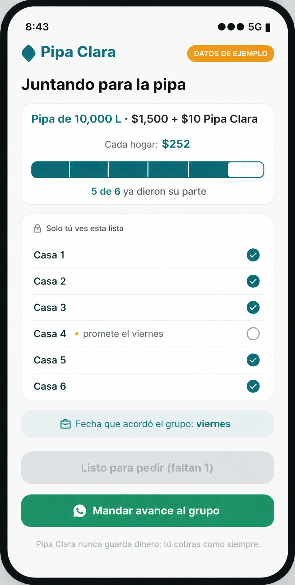
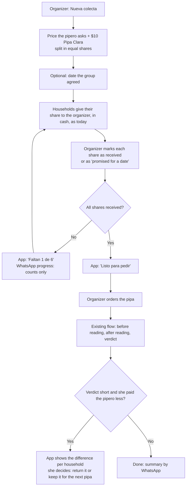

# Pipa Clara — Build Packet (Week 15, Distribution)

**Founder:** Fátima Fortes Ortega · **Venture:** Pipa Clara · **Role this week:** User
**Inputs:** [`CHARTER.md`](CHARTER.md) · Week 14 packet [`PACKET-14.md`](PACKET-14.md) · [`DECISIONS.md`](DECISIONS.md) · [`PERSONAS.md`](PERSONAS.md) · Week 15 Brain Bending brief (User) and its full conversation · Team 8 Blueprint, Week 15
Written before any Week 15 code. No packet, no code.

Evidence labels used everywhere: **A** = a real person said it · **C** = my assumption · **n=** = how many people.

---

## 1. The problem, in my words

My Brain Bending session moved my promise. Families told me problems with piperos are rare; the pain I actually heard is **late payments between neighbors**, and the person who absorbs it is the organizer. Today she often pays the pipero in full at the door and then chases each household for weeks (Charter v1 even describes it that way).

So this week has two jobs. **Product:** make the promise true in the app, with the 100% rule: the pipa is ordered only when every household has given its share, and the organizer never covers anyone. **Distribution:** make Pipa Clara recognizable and useful to the right people with a small, auditable creative process, not a pile of posts. Every piece of content must show the product, carry its evidence label, and never accuse the pipero.

## 2. Audience, user and payer

- **First user:** the **encargada** (organizer) who orders the shared private pipa and collects each household's share. One encargada told me collecting "becomes a disaster because they don't pay on time" (A, n=1). Separate-tank groups are included: whoever pays the pipero collects the money (A, n=2).
- **Payer:** the **group**, $10 MXN per pipa, about $2 per household in a cistern of 5, inside the share she already collects. Pipa Clara never holds money.
- **Moment:** the **collection window before ordering**, when the group waits for the last share. The "empty cistern" moment is still C.
- **Not targeting yet:** households with free government pipas; piperos as customers (2027 hypothesis); buildings with an administrador (untested).

## 3. Launch playbook

### 3.1 Promise

> **"Ya no pongas dinero de tu bolsa. La pipa se pide cuando ya juntaron todos, y tú ves quién falta. Los litros se miden frente al pipero: evidencia, no sentencia."**

### 3.2 Claims register (what content may say)

| Claim | Status | Source | May publish? |
|---|---|---|---|
| The pipa is ordered only when 100% is collected | Built this week (F1) | This packet | Yes, once deployed |
| Pipa Clara never holds money | Design fact | Charter, app | Yes |
| The group sees "5 de 6", never who | Built (Week 12) | App | Yes |
| $10 per pipa per group | Decided (Week 14) | `/pricing` | Yes, with "hoy no cobramos en el piloto" |
| Margin: 2 cm per reading (e.g. 160 L in a 2 × 2 m cistern) | Rule, **unverified in real cisterns** | `lib/verdict.ts` | Only with "aún no verificado" |
| Late payments are the encargada's pain | A, n=1 | Brain conversation | Only as "una encargada nos dijo…" |
| Families prefer paying the encargada in advance | **Untested** | — | **No** |
| Any % of short loads or money saved | Not measured | — | **No** |
| "Piperos roban / hacen trampa" | Contradicts Charter | — | **Never** |

### 3.3 Brand voice

A neighbor who explains, not a company that sells.
1. **Tú**, short sentences, everyday words (the site already speaks this way).
2. **Numbers carry their label** (medido / ejemplo / aún no verificado). If a claim isn't in the register, it doesn't ship.
3. **Never blame the pipero, never expose a household.** No names, no faces, no plates.
4. **No pressure:** no countdowns, no "últimos lugares", no invented waiting lists.

### 3.4 Visual system (from `app/globals.css`, documented in `docs/BRAND.md` this week)

| Token | Value | Use |
|---|---|---|
| Teal | `#12707a` (dark `#0c565e`, soft `#e2f0f1`) | Actions, headings, the brand |
| Amber | `#b45f06` (soft `#fdf3e3`) | Warnings, "faltante", labels like DATOS DE EJEMPLO |
| WhatsApp green | `#1f9150` | Only for WhatsApp buttons |
| Ink / muted / line / page | `#16272b` / `#55666a` / `#dbe5e7` / `#f2f6f7` | Text, secondary text, borders, background |
| Type | Inter, base 112.5% | Large and readable: Rosa is 55 and reads on her phone |
| Shapes | Rounded cards, flat, one idea per card | Same in content pieces |

## 4. The creative process (separate AI chats, human approval)

Each role is a separate chat with only its input. The founder approves before anything is shown to a real person. Every hand-off is saved in `docs/content/` as process evidence.

| # | Role | Input | Output | Quality check |
|---|---|---|---|---|
| 1 | Research | Concept + my evidence (A/C labels) | 3 findings, each with a source or a C label | Every finding traceable to a person or a page |
| 2 | Writing | Findings + voice rules (3.3) | Copy (≤ 40 words for WhatsApp) | Sounds like a neighbor; understandable without me |
| 3 | Visual | Copy + visual system (3.4) | Image or screen, via Canva | Uses the palette; no real faces, plates or names |
| 4 | Claim check | Piece + claims register (3.2) | Pass / fail list | Nothing outside the register; nothing blames the pipero; nobody exposed |
| 5 | Style review | Piece + 3.3 + 3.4 | Fixes | Consistent voice and look |
| 6 | Revision | Fail list | Corrected piece | Every failure closed |
| — | **Founder** | Final piece | ✅ / ❌ + written reason | My call, logged in `docs/content/approvals.md` |

**Walkthrough piece:** A1 below, run through all six roles, with what each role handed on and what I rejected.

## 5. Six concepts, three series

| Series | Concept | Format | Status |
|---|---|---|---|
| **A · Cuentas claras** (for the encargada) | **A1 "Ya no pongas de tu bolsa"**: a WhatsApp message an encargada can read and forward | WhatsApp text | **Finish + test** (walkthrough piece) |
| | A2 "Juntando: 5 de 6": the new progress message, shown from `/demo` | Screenshot | Concept |
| **B · Litros a la vista** (measurement as evidence) | **B1 "¿Cómo mido?"**: the in-app guide turned into a shareable card | Image (Canva) | **Finish** |
| | B2 "Evidencia, no sentencia": what happens when there's a difference, for honest piperos | Short video | Concept |
| **C · Lo que nos dijeron** (honest evidence) | C1 What one encargada told us, anonymous and with her permission | Image | Concept |
| | C2 "Lo que todavía no sabemos": my untested list, in public | Web section | Concept |
| — | **Venture page with opt-in** (home + "Avísame") | Web | **Finish + test** |

**Three finished assets in three formats:** A1 (text), B1 (image), venture page with opt-in (web).
**Two tests:**
1. **A1 → the real encargada.** Ask: "¿Se lo mandarías a tu grupo? ¿Qué cambiarías?" Write down her exact words.
2. **Venture page → 9 people from my sample** (5 buyers + 4 vecindad neighbors) via WhatsApp. Count opt-ins after 72 h. **Zero responses is valid evidence** and gets reported as zero.

## 6. Success definition

**Before the module closes, at www.pipa-clara.site:**
- **"Juntar antes de pedir" works in the app:** the organizer opens a collection, marks each household's share as received, and the app says **"Listo para pedir"** only at 100%. The group's WhatsApp progress message shows counts, never names.
- **The homepage speaks to the encargada** with the promise in 3.1, and the example shows payment **before** delivery.
- **`/demo` is public:** the whole flow with example data, no login, no database writes, labeled "DEMO · datos de ejemplo".
- **Opt-in works:** "¿Organizas la pipa de tu vecindad o edificio?", with explicit consent, stored safely.
- **The packet shows the process:** the walkthrough for A1, 3 finished assets, 2 tests with real results (or real zeros).

## 7. Mockup

*Generated with Canva from the screen description in Appendix A, using the Week 13–14 mockups as style reference. Example data, labeled on screen.*

## 8. How the feature works

**Who holds the money:** the organizer, in cash, as today. Pipa Clara only records it. Nobody is ever excluded from water: the pipa waits for everyone, and the date is the group's decision, not the app's.

## 9. What I build this week

| # | Feature | Acceptance |
|---|---|---|
| F1 | **Collections ("Juntar antes de pedir")** | New `pc_collections` + `pc_collection_shares` (organizer-only RLS, `pc_` prefix, nothing else in the shared project touched). Organizer creates a collection from her cistern (asked price, $10 fee, optional agreed date), marks shares received or "promised for [date]"; status `collecting → ready → ordered`; "Listo para pedir" only at 100%; "Registrar la pipa" links the collection to the new delivery so shares aren't collected twice |
| F2 | **Progress message by WhatsApp** | "Pipa Clara · Juntando para la pipa: 5 de 6 ya dieron su parte. Fecha que acordó el grupo: viernes. Cuando estemos todos, se pide." Counts only, never labels; pure function + tests like `lib/summary.ts` |
| F3 | **Homepage for the encargada** | Headline = promise 3.1; example re-ordered: "6 de 6 pagaron → se pidió → se midió"; margin written as "2 cm por lectura (300 L en esta cisterna de 3 × 2.5 m)"; "Lo que nunca cambia" keeps its three cards |
| F4 | **`/demo`** | Public, linked from home and header; walks collection → ready → readings → verdict → summary with fixed example data; no auth, no Supabase calls; every screen badged "DEMO · datos de ejemplo"; no real photos |
| F5 | **Opt-in on home** | Fields: WhatsApp or email (one required), housing type (vecindad / edificio / privada / otra), required consent checkbox "Acepto que Pipa Clara me contacte sobre esta prueba"; new `pc_optins` (anon may insert only; nobody anonymous may read); success: "Gracias. Te escribimos cuando haya lugar para tu grupo." No countdowns, no fake counts |
| F6 | **"Cómo funciona" + Precios text** | New step 0 "Junten antes de pedir"; "Pipa Clara nunca guarda dinero"; who can file a challenge (pipero, neighbor, organizer) and that a difference is evidence, not a sentence; photo notice: the pipero is told when and why a photo is taken, photos are never published; under "Guardar este escenario": "El simulador es solo para hacer cuentas: no guarda pipas ni pagos." |
| F7 | **Charter v2 + `docs/BRAND.md`** | Charter user line updated to the 100% rule (v1 kept in history); BRAND.md documents 3.3 and 3.4 |
| F8 | **Content process evidence** | `docs/content/` with one file per role hand-off for A1, the finished A1 and B1, `approvals.md`, and test results |

## 10. Scope cut: what I am NOT building this week

- No payment processing: money stays in cash with the organizer.
- No credit or debt system: a difference after a short verdict is shown, and she decides.
- No automatic reminders or messages to households: she sends the WhatsApp progress herself.
- No public social account and no ten-post quota.
- No measurement change: the 2 cm margin stays labeled unverified until I measure real cisterns.

## 11. Architecture and stack

| Layer | Choice | Change this week |
|---|---|---|
| Frontend | Next.js 16 (App Router) + React + Tailwind | Collection screens, `/demo`, homepage, opt-in form |
| Hosting | Vercel, **www.pipa-clara.site** | — |
| Auth / DB | Supabase (Google sign-in, RLS), shared project | **New:** `pc_collections`, `pc_collection_shares` (organizer-only), `pc_optins` (anon insert-only) |
| Logic | Pure functions | **New:** collection status + progress message (+ tests) |
| Content | Canva (connected), separate AI chats | B1 card, mockup |

## 12. Security floor (checked before building)

1. **No secrets:** nothing new; anon key only on the client.
2. **RLS:** collections and their shares are readable and writable only by their organizer; `pc_optins` accepts anonymous inserts and has no select policy for anon. Tested with an RLS check like `supabase/checks/`.
3. **Validation:** opt-in contact max 80 characters, email or 10-digit phone format, housing type from a fixed list, consent must be true, a hidden honeypot field rejects bots; collection amounts are integers within the delivery ranges.
4. **`/demo` touches no database** and shows no real photos or names.
5. **Personal data:** opt-ins are used only to contact that person about the pilot; `/privacidad` says so and how to ask for deletion.

## 13. Test plan

**Mechanical pass**
- Collection math: shares for 3, 5 and 12 households; status is `ready` only when every share is received; "promised" doesn't count as received; linking to a delivery happens once.
- Progress message: counts only, no labels, agreed date optional.
- RLS: another user can't read a collection; anon can insert an opt-in but can't select.
- Pages: home, `/demo`, opt-in on phone width with no horizontal scroll; opt-in rejects empty consent and the honeypot.
- Types, lint, tests, build. Find at least one bug, fix it, redeploy, log it.

**Persona pass (separate chat)**
- Rosa (PERSONAS.md) walks the collection screens from phone screenshots: does she understand "Listo para pedir", and would she send the progress message to her group? Log every confusion; fix the worst.

**Real tests** (section 5): A1 with the encargada; the venture page with 9 people. Results go in `docs/content/tests.md`, including zeros.

## 14. Blueprint conditions honored (Team 8, Week 15)

| Condition | How |
|---|---|
| 1. Shadow clause: no claim outruns its evidence | Claims register (3.2); every public number labeled; claim check is a required role |
| 2. The weakest party's data is never used against them | Nobody excluded from water; group sees counts only; no names, faces or plates in content |
| 3. A dashboard never closes what the affected person hasn't confirmed | A difference is evidence, not a sentence; challenges never deleted; "Listo para pedir" requires every share |
| 4. Beat the current workaround or recommend it | Test A1 against today's WhatsApp + cash; if the encargada prefers her current way, I report it |
| 5. No artificial scarcity, no overload | No countdowns or invented lists in the opt-in; I contact only as many groups as I can support |
| 6. Name the payer before any revenue claim | The group pays $10 per pipa; no fee is collected in the pilot; friends' opt-ins don't count as validation |

---

## Appendix A: mockup screen description

> Mobile screen, Spanish UI, app "Pipa Clara" (water-drop logo, teal #12707a and white, Inter font, large text, rounded cards, flat). Small amber badge "DATOS DE EJEMPLO". Title "Juntando para la pipa". Card: "Pipa de 10,000 L · $1,500 + $10 Pipa Clara · Cada hogar: $252". A big progress bar in teal, 5 of 6 filled, with "5 de 6 ya dieron su parte". Below, a list visible only to the organizer, with a small lock icon and the note "Solo tú ves esta lista": "Casa 1 ✓", "Casa 2 ✓", "Casa 3 ✓", "Casa 4 · promete el viernes", "Casa 5 ✓", "Casa 6 ✓". A soft teal line: "Fecha que acordó el grupo: viernes". A greyed-out button "Listo para pedir (faltan 1)". A green WhatsApp button "Mandar avance al grupo". Bottom note in small grey text: "Pipa Clara nunca guarda dinero: tú cobras como siempre."
