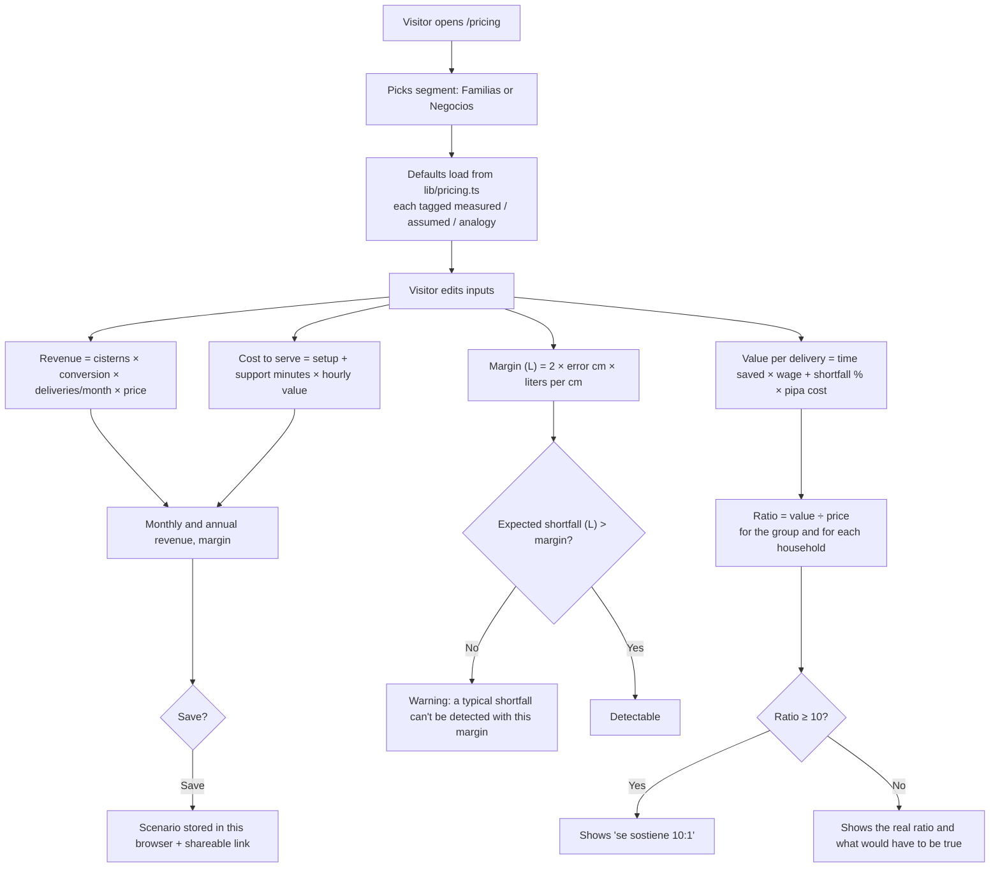
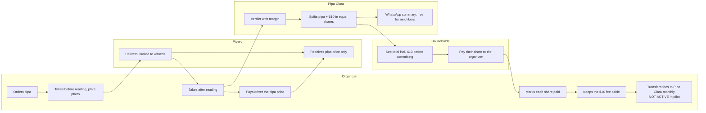

# Pipa Clara — Build Packet (Week 14, Pricing)

**Founder:** Fátima Fortes Ortega · **Venture:** Pipa Clara · **Role this week:** Adversary
**Inputs:** [`CHARTER.md`](CHARTER.md) · Week 13 packet [`PACKET-13.md`](PACKET-13.md) · [`DECISIONS.md`](DECISIONS.md) · Week 14 Brain Bending brief (Adversary) · Team 8 Blueprint, Week 14
Written before any Week 14 code. No packet, no code.

---

## 1. The problem, in my words

Pipa Clara has a price on its form ($2 per household) that I picked so nobody would say no. That is the politeness price this week's provocation is about, and my own Brain Bending fight killed it: I could not say who it is for, how it reaches me, or why it is worth paying.

This week the price has to tell the truth. Anyone, including me, must be able to see **who pays, how much, for what, compared with what they do today, and which numbers are measured and which are guesses.** The uncomfortable part is that most of the value rests on one number nobody has measured (how often a pipa delivers short), and on a margin of error that can be bigger than the shortfall it is supposed to catch. The site must show that, not hide it.

## 2. The exact user, and who actually pays

- **User:** the organizer, the person in a group of households sharing a cistern who orders the private pipa, pays the driver and keeps the record. Same person as Weeks 12–13. These are families who buy private pipas because the government pipa doesn't arrive when promised or when they need it.
- **Who pays (Families tier):** the households, through their share. Pipa Clara's fee is **$10 per delivery**, added to the cost of the pipa and split in the same equal shares the organizer already collects (about $2 per household in a cistern of 5). Everyone sees the total before they commit.
- **Who never pays:** the driver and the water company (the party measured cannot fund the measurement). The neighbors never pay anything separate and never need the app: they receive the WhatsApp summary free.
- **Second segment:** small businesses that buy private pipas (fondas, tortillerías, laundries; car washes excluded). The business owner is user and payer.

## 3. Success definition

**Before the module closes, at www.pipa-clara.site:**

- **`/pricing` is live** with 3 tiers (Vecinos free, Familias $10 per delivery, Negocios priced from data), 2 segments, and the free-vs-paid line explained.
- **The simulator works:** users, conversion, deliveries per month and price → monthly and annual revenue, cost to serve and margin; plus the value ratio per payer and whether the expected shortfall is even detectable with the cistern's margin of error. **Every assumption is visible and labeled measured / assumed / analogy.** Scenarios can be **saved** and **shared by link**.
- **`/about` holds the 10:1 memo,** built from the same numbers as the simulator (one source file), with the honest result even where it misses 10:1.
- **The real pricing conversation is logged on `/pricing`,** with asked / said yes / approved in writing / paid / renewed as separate states. A "no" counts as evidence.
- **The delivery form defaults to the new price** ($10 per delivery split among households).

## 4. Mockup

*Generated from the screen description in Appendix A with the founder's LLM image generation. Example data, labeled on screen.*

## 5. How the feature works

### 5.1 Flowchart: from assumptions to price, ratio and detectability

### 5.2 Swimlane: who does what with the money for one delivery

The fee never passes through the pipero's hands (Brain Bending, open Kill #2).

## 6. What I build this week

| # | Feature | Acceptance |
|---|---|---|
| P1 | **`lib/pricing.ts`**: one source for every assumption and the pure math | Each assumption has value, unit, status (`measured` / `assumed` / `analogy`) and source; functions for revenue, cost to serve, value per delivery, ratios, detectability; unit tests |
| P2 | **`/pricing` page**: tiers, segments, free-vs-paid line, shadow clause | 3 tiers, 2 segments; header link "Precios" |
| P3 | **Simulator** (client component) | Inputs → outputs update live; assumptions labeled; "SIMULACIÓN" badge; validation (ranges, numbers only) |
| P4 | **Saved scenarios** | Save with a name in this browser (`localStorage`, try/catch, works without it); "Copiar enlace" encodes inputs in the URL; opening the link restores them; no personal data |
| P5 | **10:1 memo on `/about`** | Today's workflow vs Pipa Clara, same task (one delivery) and period; money + time + risk; measured vs assumed; ratio per payer; reads its numbers from `lib/pricing.ts` |
| P6 | **Pricing conversation log** on `/pricing` | Entries from `lib/pricing-conversations.ts` with separate states; the pending conversation shows the exact question |
| P7 | **Form default = new price** | "Nueva pipa" fee default per household = `max(1, round(10 / households))` (5 → $2, 3 → $3, 12 → $1); label explains "$10 por pipa, repartido" |

## 7. The pricing math (pure, checkable by hand)

- **Revenue/month** = cisterns reached × conversion × deliveries per month × price.
- **Cost to serve/month** = (new cisterns × setup min + active cisterns × support min) ÷ 60 × founder hourly value. Hosting $0 (free tiers).
- **Value per delivery** = max(0, collection hours − measuring hours) × hourly wage (Families only; a business has no shares to collect) + shortfall rate × pipa price.
- **Ratios:** group = value ÷ price. Each household = (shortfall value ÷ households) ÷ (price ÷ households) = shortfall value ÷ price, the honest number the Adversary found (about 2:1).
- **Price at 10:1** = value ÷ 10 (used for the Negocios tier).
- **Detectability:** margin L = 2 × error cm × length × width × 10 (same as `computeVerdict()`); expected shortfall L = rate × liters claimed. Not detectable when shortfall ≤ margin.
- **Worked example (defaults):** pipa $1,800, 10,000 L, 1.1% shortfall → $19.80; 1.5 h collecting − 10 min measuring = 1.33 h × $39.38 = $52.51; value $72.31 → **7.2:1 at $10, not 10:1.** Cistern 3 × 2.5 m, 2 cm error → 75 L/cm → margin 300 L; expected shortfall 110 L → **not detectable.** The site says both.

## 8. Benchmark line

- **The best existing solution on Earth for this is** LP gas in stationary tanks in Mexico: the household checks the tank's level against the liters charged, backed by a meter Profeco regulates.
- **Mine localizes it by** giving water pipas the same before/after check with no regulated meter, so every verdict declares its own margin of error, and its price is set by what that check is worth to the family that buys out of necessity.

## 9. The long view

If this slice works, Pipa Clara has a price it can defend and a simulator that updates itself as real deliveries replace the gasoline analogy. In three years the fee from families and businesses that buy regularly pays for the measurement, and a measured shortfall rate is the number that tells water companies and regulators whether pipa water needs a meter like LP gas. The load-bearing walls this week are that every assumption is labeled, the fee never touches the pipero, and payment never changes a verdict.

## 10. Scope cut: what I am NOT building this week

- No payment processing or fee collection (no Clip, no transfers): the monthly transfer is shown as **not active in the pilot**.
- No change to the database or the payment flow (families still pay their share to the organizer); "pay at the door after the after reading" from Brain Bending is a later change.
- No business accounts or business-specific screens; the Negocios tier lives on `/pricing` and in the simulator only.
- No scenarios stored in Supabase (no auth needed, no personal data).
- No run-out prediction (needs readings between deliveries; Rotoplas already sells that sensor).

## 11. Architecture and stack

Same stack as Week 13; only additions are listed.

| Layer | Choice | Change this week |
|---|---|---|
| Frontend | Next.js 16 (App Router) + React + Tailwind | `/pricing` page, simulator client component, `/about` memo |
| Hosting | Vercel, **www.pipa-clara.site** | — |
| Auth / DB | Supabase (Google sign-in, RLS) | **None** |
| Logic | Pure functions | **New:** `lib/pricing.ts` (+ tests); `lib/pricing-conversations.ts` (data) |
| Storage | — | Saved scenarios in `localStorage` (per browser) + URL query for sharing |

## 12. Security floor (checked before building)

1. **No secrets:** nothing new.
2. **Auth:** `/pricing` and `/about` are public and store nothing personal; the app stays behind Google sign-in.
3. **RLS:** no new tables.
4. **Validation:** every simulator input clamped to a range and parsed as a number; scenario names max 40 characters; URL parameters parsed the same way, unknown keys ignored.
5. **No real personal data:** the conversation log records role and segment, never names or phone numbers; simulated numbers labeled "SIMULACIÓN".

## 13. Test plan

**Mechanical pass**

- `lib/pricing.ts`: worked example above (7.2:1, 300 L margin, not detectable); value never negative when measuring takes longer than collecting; business value has no time component; price at 10:1; revenue/cost with 0 conversion; URL encode → decode round trip; out-of-range values clamped.
- Pages: `/pricing` and `/about` render on phone width with no horizontal scroll; saving works and survives reload; saving with storage blocked shows a message, not a crash; a shared link restores the scenario in a private window.
- Delivery form: default fee for 3, 5 and 12 households.
- Types, lint, tests, build. Find at least one bug, fix it, redeploy, log it.

**Persona pass (Layer 1, separate chat)**

- A fonda owner in Iztapalapa who buys private pipas several times a week in dry months, uses WhatsApp, distrusts apps and reads numbers carefully. She walks `/pricing` from screenshots and says whether she understands what she would pay and why. Log every confusion; fix the worst.

## 14. Blueprint conditions honored (Team 8, Week 14)

| Condition | How |
|---|---|
| 1. User and budget owner identified; total price and scope disclosed | Each tier names user and payer; $10 shown inside the delivery total before households commit |
| 2. Quote request, written approval, payment, renewal logged separately; simulated labeled | Conversation log with separate states; simulator badge "SIMULACIÓN" |
| 3. Compare with the current workflow; verified benefit ÷ total cost vs 10:1 | 10:1 memo: notebook + cash collection vs Pipa Clara, same delivery; ratio shown even when below 10 |
| 4. Track setup, support and delivery costs incl. founder labor | Cost to serve in the simulator: setup and support minutes × hourly value |
| 5. Shadow clause | Payment buys the service, never a different verdict; evidence and margin always visible; disagreements never deleted; the fee never passes through the pipero |

---

## Appendix A: mockup screen description

> Mobile screen, Spanish UI, app "Pipa Clara" (water-drop logo, teal and white), amber badge "SIMULACIÓN". Title "¿Cuánto vale Pipa Clara?". Two tabs: "Familias" (selected) and "Negocios". Input rows with small grey tags: "Precio de la pipa $1,800 · medido", "Faltante esperado 1.1% · analogía gasolina, sin validar", "Horas cobrando 1.5 · supuesto", "Cuota Pipa Clara $10 por pipa". A large result card: "Valor por pipa: $72 · Precio: $10 · 7.2 a 1" with an amber note "Todavía no llega a 10 a 1". Below, an amber box: "Con un margen de 300 L, un faltante de 110 L no se puede detectar." Bottom: "Ingresos al mes: $1,200 · al año: $14,400" and buttons "Guardar escenario" and "Copiar enlace". Large readable text, flat, no clutter.
