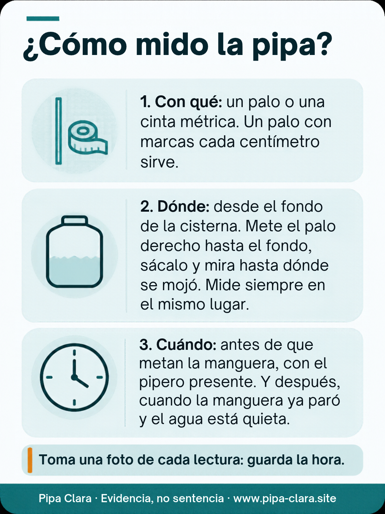

# B1 "¿Cómo mido la pipa?" · final

- **Pieza:** B1 "¿Cómo mido la pipa?" · formato imagen 3:4 para WhatsApp (1080 × 1440 px) · hecha en Canva.
- **Fuente del texto:** Text from MeasureGuide plus two lines from Charter principle 1 and the app's timestamped photo; no new claims.
- **Imagen:** [`docs/content/B1-como-mido.png`](../B1-como-mido.png)
- **Link de Canva:** https://canva.link/1blmgxf6qnfyrif
- **Version / date:** 2026-11-22, corrected export ("pipero" without accent)
- **Approved by the founder:** ✏️ Approved with fix, see [`../approvals.md`](../approvals.md)

## Evidence labels used in the piece

No numbers on the card, so no labels needed.
